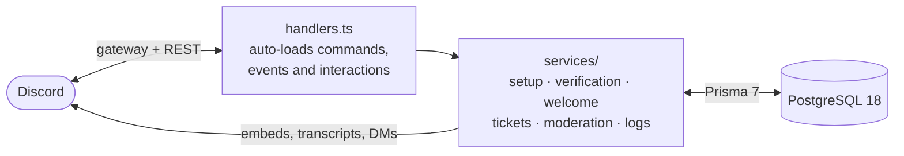

<div align="center">

# 🚆 Railcore

**The Discord bot for Falkenberg Railways, a Roblox railway simulator.**
<br>
Verification, welcome messages, tickets, staff applications, moderation and logs, all configured from inside Discord.

[](https://github.com/Juqutsu/Railcore/actions/workflows/ci.yml)


[Features](#-features) · [Commands](#-commands) · [Quick start](#-quick-start) · [Setup in Discord](#-set-it-up-in-discord) · [Game stats](#-game-stats) · [Deploy](#-deploy-with-docker) · [Development](#%EF%B8%8F-development)

</div>

---

## ✨ Features

|     | Module                 | What it does                                                                                                                                                                                                                                                                           |
| --- | ---------------------- | -------------------------------------------------------------------------------------------------------------------------------------------------------------------------------------------------------------------------------------------------------------------------------------- |
| 🎫  | **Verification**       | A rules panel with a Verify button. Checks the Discord account age against a minimum, has an anti-spam cooldown and alerts staff about accounts that are too new. Built as its own module, ready for a Roblox account link.                                                            |
| 👋  | **Welcome & leave**    | A greeting card with a ping when someone joins, and an announcement when someone leaves. Both texts are editable in `/setup` with `{user}`, `{name}`, `{server}` and `{count}`.                                                                                                        |
| 🛟  | **Tickets**            | Support, Bug Report and message-report tickets in private channels. Claim and Close buttons, `/ticket add` and `/ticket remove`, a reminder and auto-close when the opener stops answering staff, and an HTML transcript with images and files embedded.                               |
| 📋  | **Staff applications** | Application tickets with Accept and Deny buttons, a private staff note, a DM to the applicant, and the application role on acceptance.                                                                                                                                                 |
| 🛡️  | **Moderation**         | Warn, timeout, kick, ban and purge. Every action becomes a numbered case with a mod-log entry. Actions on members also DM them and check the role hierarchy.                                                                                                                           |
| 🖱️  | **Right-click menu**   | Warn, Timeout and Show warnings on a member. Report message on any message, which opens a private report ticket with a copy of it.                                                                                                                                                     |
| 🚆  | **Game stats**         | `/stats` shows a member's XP, points, trips, kilometres and stops from the Roblox game, found through their Bloxlink link. `/leaderboard` shows the top 100 by XP or distance, 10 per page, with buttons to page through and switch boards. Read-only: the bot never writes game data. |
| 🎖️  | **XP roles**           | Stackable Discord roles for in-game XP thresholds you set in `/setup`, kept in sync automatically, with rank-up announcements and the rank on the `/stats` card.                                                                                                                       |
| 📜  | **Server log**         | Message edits and deletions, bulk deletes, joins, leaves, role changes and nickname changes.                                                                                                                                                                                           |
| ⚙️  | **`/setup` dashboard** | Every channel, role, number and text is set in Discord. The dashboard warns when the bot lacks permissions. No IDs live in the code.                                                                                                                                                   |



## 💬 Commands

| Command                                           | Who can use it   | What it does                                                                                                                                        |
| ------------------------------------------------- | ---------------- | --------------------------------------------------------------------------------------------------------------------------------------------------- |
| `/setup`                                          | Manage Server    | Opens the settings dashboard (only you see it)                                                                                                      |
| `/verify-panel`                                   | Manage Server    | Posts the verification panel in the verification channel                                                                                            |
| `/ticket-panel`                                   | Manage Server    | Posts the ticket panel in the current channel                                                                                                       |
| `/ticket add` · `/ticket remove`                  | Staff roles      | Gives a member access to the current ticket, or takes it away                                                                                       |
| `/warn` · `/warnings` · `/clearwarn`              | Moderate Members | Warns a member, lists active warnings, clears one or all                                                                                            |
| `/timeout` · `/untimeout`                         | Moderate Members | Times a member out (`10m`, `2h`, `1d`, up to 28 days) or lifts it                                                                                   |
| `/kick`                                           | Kick Members     | Kicks a member                                                                                                                                      |
| `/ban` · `/unban`                                 | Ban Members      | Bans (optionally deleting the last hour, day or week), unbans by ID                                                                                 |
| `/purge`                                          | Manage Messages  | Deletes up to 1–100 of the last 100 messages, optionally one user's                                                                                 |
| Right-click member → Warn, Timeout, Show warnings | Moderate Members | Same as the slash commands, with a short form                                                                                                       |
| Right-click message → Report message              | Everyone         | Opens a private report ticket with a copy of the message                                                                                            |
| `/stats [user]`                                   | Everyone         | Posts a member's game stats in the channel (default: your own)                                                                                      |
| `/leaderboard [by]`                               | Everyone         | Posts the top 100 drivers by XP (default) or distance, with page and board buttons. Only you flip your message; others who click get a private copy |

Staff roles come from `/setup`, and administrators always count as staff. You can change who sees each command in **Server Settings → Integrations → Railcore**, but the `/setup` dashboard re-checks **Manage Server** on every click, and the right-click Warn and Timeout forms re-check **Moderate Members** when they are sent. For actions on members the role hierarchy applies: nobody can moderate themselves, the owner, the bot, or someone with an equal or higher role.

## 🚀 Quick start

You need **Node.js 24** (LTS). Docker is not needed for development.

```bash
git clone https://github.com/Juqutsu/Railcore.git && cd Railcore
npm install
cp .env.example .env     # then fill in DISCORD_BOT_TOKEN and TEST_SERVER_ID
npm run db:dev           # starts a local PostgreSQL 18 in the background (first run sets it up)
npm run db:migrate       # creates the tables
npm run commands:dev     # registers the slash commands on your test server
npm run dev              # starts the bot and restarts it when you save a file
```

`npm run db:dev` runs a real PostgreSQL 18 (the same major version as in Docker) from the `embedded-postgres` package. You don't need Docker or admin rights for it. It listens on `localhost:5433` only, which matches the URL in `.env.example`, and keeps its data in `.dev-db/`. Running it again while the database is up is harmless, and `npm run db:stop` shuts it down.

`npm run dev` also starts the database if it isn't running, for example after a reboot. To start over with an empty database, run `npm run db:stop`, delete `.dev-db/`, then run `npm run db:dev` and `npm run db:migrate`.

### Create the Discord bot

1. Open the [Discord Developer Portal](https://discord.com/developers/applications), click **New Application** and name it "Railcore".
2. Go to **Bot**, click **Reset Token** and copy the token. It goes into `.env`; never share it.
3. Still on **Bot**, under **Privileged Gateway Intents**, turn on **Server Members Intent** and **Message Content Intent**. The bot refuses to start without them.
4. Invite the bot. Replace `APP_ID` with the **Application ID** from **General Information**:

   ```
   https://discord.com/oauth2/authorize?client_id=APP_ID&scope=bot+applications.commands&permissions=1099780189206
   ```

   This grants View Channels, Send Messages, Embed Links, Attach Files, Read Message History, Manage Channels, Manage Roles, Manage Messages, Kick Members, Ban Members and Moderate Members.

5. In **Server Settings → Roles**, drag the Railcore role **above** the Verified role, the application role, and every role the bot should be able to moderate. Discord only lets a bot manage roles below its own.

### Environment variables

| Variable            | Needed for         | What it is                                                                                                                                             |
| ------------------- | ------------------ | ------------------------------------------------------------------------------------------------------------------------------------------------------ |
| `DISCORD_BOT_TOKEN` | always             | The bot token from the Developer Portal.                                                                                                               |
| `TEST_SERVER_ID`    | `commands:dev`     | ID of your test server (enable Developer Mode in Discord, then right-click the server → Copy Server ID).                                               |
| `PROD_SERVER_ID`    | `commands:prod`    | ID of the production server. With both server IDs set, the bot works only on these two servers and leaves any other (see [Server lock](#server-lock)). |
| `DATABASE_URL`      | local dev          | Postgres connection URL. In Docker it is built from the `POSTGRES_*` values and this line is ignored.                                                  |
| `POSTGRES_USER`     | Docker             | Database user. Default `railcore`.                                                                                                                     |
| `POSTGRES_PASSWORD` | Docker             | Database password. Use letters and digits only, because it becomes part of a URL. **Change it.**                                                       |
| `POSTGRES_DB`       | Docker             | Database name. Default `railcore`.                                                                                                                     |
| `ROBLOX_API_KEY`    | game features      | Roblox Open Cloud key with read access to the game's data stores (see [Game stats](#-game-stats)).                                                     |
| `BLOXLINK_API_KEY`  | `/stats`, XP roles | Bloxlink server API key, used to find a member's linked Roblox account.                                                                                |
| `LOG_LEVEL`         | optional           | `fatal`, `error`, `warn`, `info` (default), `debug` or `trace`.                                                                                        |
| `NODE_ENV`          | set by Docker      | `production` switches logs to JSON. Leave it unset locally for readable, colored logs.                                                                 |

### Register the slash commands

Discord only shows commands that have been registered. Register again whenever you add a command or change its name, description or options.

| Command                           | Where                          | When to use                                                                 |
| --------------------------------- | ------------------------------ | --------------------------------------------------------------------------- |
| `npm run commands:dev`            | Only `TEST_SERVER_ID`, instant | While developing                                                            |
| `npm run commands:prod`           | Only `PROD_SERVER_ID`, instant | Production                                                                  |
| `npm run commands:global`         | Every server the bot is in     | Only if the bot serves other servers too. Can take a few minutes to appear. |
| `npm run commands:dev -- --clear` | Removes the test-server copies | After going global, to avoid duplicates                                     |

Use `commands:dev` and `commands:prod`, not `commands:global`: then each server has exactly one copy. If commands are registered both on a server and globally, they show up twice there. If you used `commands:global` before, remove the global copies once with `npm run commands:global -- --clear` (Docker: `docker compose run --rm bot node dist/scripts/deploy-commands.js --global --clear`).

### Test and production

The bot on your PC and the one on the VPS share the bot token, so both receive everything from both servers. Each copy handles **only its own server** and ignores the other completely:

- **Docker (`NODE_ENV=production`)**: only `PROD_SERVER_ID`, with the VPS database.
- **Anywhere else, e.g. `npm run dev`**: only `TEST_SERVER_ID`, with your local database.

So each server's settings, tickets, cases and XP roles live in that copy's own database, and running both copies at once never answers anything twice. The startup log says which server a copy handles. Settings you made for the production server from your PC before this existed stay in your local database; set them up again on the VPS. Without the matching ID, a copy handles every allowed server.

### Server lock

With **both** `TEST_SERVER_ID` and `PROD_SERVER_ID` set, the bot only works on those two servers. If someone adds it to another server, it leaves right away. At startup it leaves every other server it is still in, but only while it is in both of these servers, so a wrong ID can't make it leave the real one. Use the **same two IDs** in every `.env` that uses this bot token (your PC and the VPS): a copy with a wrong ID would leave the server that ID should name as soon as the bot joins it. The two IDs must differ. With only one ID or none, there is no lock.

## 🧭 Set it up in Discord

1. Run **`/setup`** and set each item from the menu:
   - **Verification**: verification channel, Verified role, minimum account age (default 7 days, `0` turns the check off).
   - **Welcome & leave**: the welcome and leave channels (not set = no message) and their texts. Texts can use `{user}` (mention), `{name}` (display name), `{server}` and `{count}` (member count). **Use default** goes back to the built-in text. Only the new member is pinged, even if the text contains `@everyone`. Bots get no messages.
   - **Tickets & applications**: ticket category, ticket log channel, staff roles, the application role that accepted applicants get, **Staff applications** on or off, and the reminder and auto-close times. With applications off, the Staff Application button on the ticket panel is greyed out ("Applications closed") and new applications are refused, even from older panels or forms that were already open. Application tickets that are already open carry on as usual. When staff wrote last and the opener stays quiet, the opener is reminded after the reminder time, and the ticket closes once the auto-close time has passed after that (default 24 + 24 hours). A reminder time of `0` turns both off; an auto-close time of `0` keeps only the reminder.
   - **Logs**: mod log channel and server log channel.
   - **Game**: the rank-up channel and the **XP roles** (see [XP roles](#xp-roles)).

   The dashboard warns you when the bot is missing permissions in a channel you pick.

2. Run **`/verify-panel`**. It posts the panel in the verification channel.
3. Run **`/ticket-panel`** in the channel where members should open tickets. The bot updates the panel right away when you switch applications on or off. It remembers the newest panel; panels posted before that are found among the last 50 messages of each channel.
4. Hide your normal channels from `@everyone` and allow the Verified role, so only verified members see them. Keep the welcome channel visible to `@everyone` if new members should see their greeting before they verify.

## 🚆 Game stats

`/stats` reads the player's profile from the game's data store `FBR_Progress_v1` through Roblox Open Cloud. It finds the Roblox account through **Bloxlink**, so members must be verified with Bloxlink on the server. `/leaderboard` reads the game's ordered data stores `FBR_Leaderboard_XP_v1` and `FBR_Leaderboard_Km_v1` and only needs the Roblox key. Both keys go into `.env`; never paste them into a chat.

1. **Roblox key**: in the Creator Hub, open **Open Cloud → API Keys → Create API Key** and pick the **group** that owns Falkenberg Railways as the owner. Add the **DataStore** API system for the game's universe with read access only (`universe-datastores.objects:read`, limited to `FBR_Progress_v1` if you can), plus read access to **ordered data stores** for `/leaderboard`. Add the server's IP under **Accepted IP Addresses** if it is fixed, and set an expiry date.
2. **Bloxlink key**: on [blox.link](https://blox.link), open **Dashboard → Developer**, pick this server and create a server API key.
3. Put both into `.env` as `ROBLOX_API_KEY` and `BLOXLINK_API_KEY`, then restart the bot.

Good to know:

- The game saves at least once a minute while someone plays, and the bot caches each profile for a minute, so stats can be about two minutes behind.
- The leaderboards are written at most once a minute per player and cached for a minute. Studio test profiles (negative user IDs) never appear.
- A player who never played shows a "hasn't played yet" card. Missing or broken values count as 0, the same way the game treats them.
- The bot only reads. It never writes to the game's data stores.

### XP roles

Members get Discord roles for their in-game XP, for example Trainee from 25 XP and Driver from 150 XP. Roles **stack**: someone with 200 XP has both. Set them up in **`/setup` → XP roles**: **Add or change** picks a role and its XP, the menu above removes one, and **Sync everyone now** checks every member at once.

- **Keeping them right**: every member has exactly the XP roles their XP reaches. The bot adds missing ones and removes ones that no longer fit, for example after you raise a threshold or someone unlinks their Roblox account. Roles that aren't XP roles are never touched. Removing an XP role from the list leaves it on members; the bot just stops managing it.
- **When it updates**: every 10 minutes for members the bot already knows, right away on `/stats` and when someone joins, and once a day (or with **Sync everyone now**) for all members through Bloxlink, which finds new links and unlinks. The daily pass asks Bloxlink one member per second.
- **Rank-ups**: set a **Rank-up channel** in `/setup` → Game, and the bot announces "🎉 @member is now @Driver!" when someone reaches a new role by playing. Setting up roles or changing thresholds announces nothing.
- **On `/stats`**: the card shows the member's rank and the XP to the next one.
- **Which roles qualify**: the bot's role must be above every XP role, and you can only add roles below your own highest role (you also need **Manage Roles**, except the owner), the same rule as handing out a role by hand. Roles with staff permissions such as Administrator, Manage Server, Manage Roles or Ban Members can't be XP roles. If an XP role later gains such a permission, is dragged above the bot's role, or is deleted, the bot stops giving or taking it until you fix or remove it.
- **Members in Membership Screening** get no XP roles until they have accepted the rules, so roles never let them skip screening.

## 🐳 Deploy with Docker

On the server (any Linux VPS, 1 GB RAM is plenty):

```bash
# Install Docker Engine and the compose plugin once
curl -fsSL https://get.docker.com | sh

# Get the code and configure it
git clone https://github.com/Juqutsu/Railcore.git railcore && cd railcore
cp .env.example .env
nano .env                # set DISCORD_BOT_TOKEN, both server IDs and a strong POSTGRES_PASSWORD

# Build and start the bot and Postgres in the background
docker compose up -d --build

# Register the commands on the production server (once, and again after command changes)
docker compose run --rm bot node dist/scripts/deploy-commands.js --prod

# Watch the logs
docker compose logs -f bot
```

- **Migrations** run automatically every time the bot container starts (`prisma migrate deploy`).
- **Restarts**: both containers restart on their own after crashes and reboots (`restart: unless-stopped`).
- **The database** is only reachable from inside Docker. No port is opened to the internet. Its data lives in the `pgdata` volume.
- **Logs** are JSON and rotate automatically (3 × 10 MB per container).

### Updating

```bash
git pull
docker compose up -d --build
# only if commands changed:
docker compose run --rm bot node dist/scripts/deploy-commands.js --prod
# once, if you registered commands with --global before (otherwise they show up twice):
docker compose run --rm bot node dist/scripts/deploy-commands.js --global --clear
```

### Backups

```bash
# Backup (the dump replaces existing tables when restored)
docker compose exec db pg_dump --clean --if-exists -U railcore railcore > railcore-$(date +%F).sql

# Restore: stop the bot first so nothing writes in the meantime
docker compose stop bot
docker compose exec -T db psql -U railcore railcore < railcore-2026-01-01.sql
docker compose start bot
```

Use your own `POSTGRES_USER` / `POSTGRES_DB` if you changed them.

> [!CAUTION]
> `docker compose down` stops everything but keeps the data. `docker compose down -v` also **deletes the database volume**, and all cases, tickets and settings with it.

## 🛠️ Development

### Scripts

| Script                    | What it does                                                           |
| ------------------------- | ---------------------------------------------------------------------- |
| `npm run dev`             | Start with auto-reload (tsx)                                           |
| `npm run build`           | Generate the Prisma client and compile to `dist/`                      |
| `npm start`               | Run the compiled bot from `dist/`                                      |
| `npm run commands:dev`    | Register slash commands on the test server (`-- --clear` removes them) |
| `npm run commands:prod`   | Register slash commands on the production server (`-- --clear` too)    |
| `npm run commands:global` | Register slash commands globally                                       |
| `npm run db:dev`          | Start the local PostgreSQL in the background                           |
| `npm run db:stop`         | Stop the local PostgreSQL                                              |
| `npm run db:migrate`      | Create and apply a migration after changing `prisma/schema.prisma`     |
| `npm run db:deploy`       | Apply existing migrations without creating new ones                    |
| `npm run typecheck`       | TypeScript check                                                       |
| `npm run lint`            | ESLint                                                                 |
| `npm run format`          | Prettier                                                               |
| `npm test`                | Unit tests (Node's built-in test runner)                               |

Every push to `main` and every pull request runs typecheck, lint, the Prettier check, the tests and a Docker build on GitHub Actions.

### Project structure

```
src/
├─ index.ts            Startup, intents, graceful shutdown
├─ env.ts              Validates .env
├─ text.ts             All user-facing text
├─ handlers.ts         Loads commands, events and interactions automatically
├─ commands/           Slash and right-click commands, one file each (admin/, context/, verification/, tickets/, moderation/, game/)
├─ events/             Discord events (interactions, welcome and server log, ready)
├─ interactions/       Buttons, select menus and modals (buttons/, selects/, modals/)
├─ services/           Feature logic: setup, verification, welcome, game stats (roblox), XP roles, tickets, applications, transcripts, moderation, logs
├─ database/           Prisma client
├─ utils/              Embeds, errors, permissions, durations, cooldowns, templates, game progress, XP tiers, logger
└─ scripts/            deploy-commands.ts, dev-db.ts
prisma/
├─ schema.prisma       Database schema
└─ migrations/         SQL migrations, applied in order
```

### Customizing

- **Wording**: every message, button label and command description is in [`src/text.ts`](src/text.ts). Edit freely, but keep the function signatures.
- **Colors**: [`src/utils/embeds.ts`](src/utils/embeds.ts). Every embed in the bot is created there. The footer text is `footer` in `src/text.ts`.
- **Ticket questions**: question text is in `src/text.ts` under `tickets.questions`. Lengths and order are in `QUESTIONS` in [`src/services/tickets.ts`](src/services/tickets.ts). A modal holds at most 5 questions.
- **A new command**: add a file in `src/commands/<group>/` that default-exports `defineCommand({ data, execute })`, then register the commands again. The loader picks the file up automatically.
- **A new button or modal**: add a file in `src/interactions/<buttons|selects|modals>/` that default-exports `defineComponent({ kind, id: 'scope:action', execute })`. A button with the custom ID `scope:action:arg1:arg2` calls that handler with `['arg1', 'arg2']`.
- **Database changes**: edit `prisma/schema.prisma`, then run `npm run db:migrate -- --name what-changed`. Commit the new folder in `prisma/migrations/`.

## 🩺 Troubleshooting

| Symptom                                                                                | Fix                                                                                                                                                                       |
| -------------------------------------------------------------------------------------- | ------------------------------------------------------------------------------------------------------------------------------------------------------------------------- |
| `Startup failed` with `Used disallowed intents`                                        | Turn on both privileged intents (see [Create the Discord bot](#create-the-discord-bot)).                                                                                  |
| `Startup failed` with `Can't reach database server` or `Connection terminated` (local) | The local database isn't running. Run `npm run db:dev`; if it still fails, look at `.dev-db/postgres.log`.                                                                |
| Users see "I'm missing a permission to do that"                                        | Check the bot's role position and its permissions in that channel. Picking a channel again in `/setup` tells you which permissions are missing.                           |
| A command is missing                                                                   | Register the commands again (see [Register the slash commands](#register-the-slash-commands)).                                                                            |
| Commands show up twice                                                                 | Registered on the server and globally: run `npm run commands:dev -- --clear` (or `commands:prod -- --clear`), or clear the global ones with `commands:global -- --clear`. |
| The bot left a server right after joining                                              | The [server lock](#server-lock) is on and that server isn't `TEST_SERVER_ID` or `PROD_SERVER_ID`. Check both IDs in `.env`.                                               |
| Users see "Something went off the rails … Reference: `abc123`"                         | Search the logs for `"ref":"abc123"` (or `ref: "abc123"` locally) to find the full error.                                                                                 |
| `/stats` says `api.blox.link` rejected the bot's API key                               | The log shows Bloxlink's reason. `Guild ID does not match API Key` means the key was made for another server: create one for the server the bot runs on.                  |
| `/stats` says `apis.roblox.com` rejected the bot's API key                             | The Roblox key is expired, lacks read access to `FBR_Progress_v1`, or the server's IP isn't in its **Accepted IP Addresses**.                                             |

## 📌 Known limitations

- **XP role sync speed**: the daily Bloxlink pass checks one member per second, so a server with 3,000 members needs about 50 minutes. Members who link their account in between are picked up on `/stats` or by that pass.
- **Single bot process**: the settings cache and the ticket-close lock live in memory. Don't run two copies of the bot against the same database.
- **Server log content**: Discord only sends a message's old text if the bot had it cached. The cache covers messages sent since the last start, up to the last 200 per channel. Edits of older messages show the old text as "Unknown", and deletions of older messages aren't logged.
- **No "changed by" in the server log**: role and nickname changes don't say who made them. That would need audit-log lookups.
- **Files in transcripts**: up to 4 MB of images and files per ticket are embedded in the transcript, so the HTML stays under Discord's upload limit. Anything beyond that stays a Discord link, which expires after about a day, and is marked as such. If the upload still fails, the bot retries once with all files as links.
